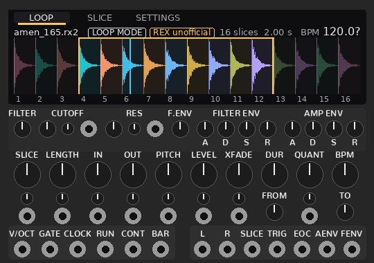
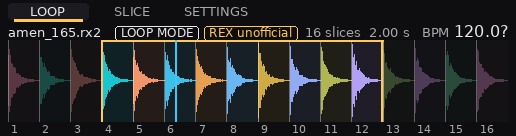
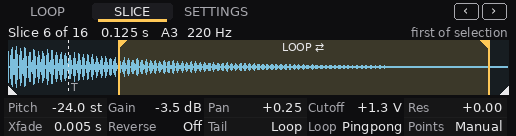
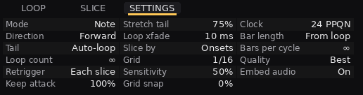

# Spools

Spools is a VCV Rack 2 loop player and slicer for big drum-loop collections.
It is in development; [CHANGELOG.md](CHANGELOG.md) lists what each release
adds. Licensed GPL-3.0-or-later.



- Loads REX2 (unofficial decoder), Acidized WAV, AIFF, FLAC, MP3 and Ogg, and
  slices plain audio by onsets, grid or both, with tempo estimation.
- Plays slices on your clock: gates and V/OCT pick phrases in note mode, or the
  loop runs continuously in loop mode with RUN/CONT/BAR transport.
- Polyphonic, up to 16 voices, each with a multimode filter, filter and amp
  envelopes, and per-slice pitch, level, pan, trims, cutoff and resonance.
- Tail modes fit each slice to its time: Ring, Cut, Loop (manual points,
  crossfade or ping-pong), Auto-loop (searched, pitch-period loops) and
  granular Stretch at the original pitch.
- A display with LOOP (slice editing, crop), SLICE (one slice up close, loop
  points, per-slice fields) and SETTINGS pages; every edit can be undone.

The [manual](docs/manual.md) covers all of it.
[DESIGN.md](DESIGN.md) is the plan, [TODO.md](TODO.md) tracks progress, and
[docs/development.md](docs/development.md) has the code layout, tests and
benchmarks.

| LOOP | SLICE | SETTINGS |
|---|---|---|
|  |  |  |

The images are 100%-scale previews rendered from the layout code, not Rack
screenshots yet.

## Building

Download and unpack the [Rack 2 SDK](https://vcvrack.com/manual/Building)
for your platform. Install a C++ compiler, GNU Make, `jq`, GNU tar and `zstd`,
then build and package the plugin:

```sh
make RACK_DIR=/path/to/Rack-SDK
make dist RACK_DIR=/path/to/Rack-SDK
```

The package is written to `dist/`. Run the core unit tests with `make test`
and the CPU benchmark with `make bench` (no SDK required for either). CI builds Linux x64, Windows x64, macOS x64,
and macOS ARM64 with the Rack 2.6.6 SDK. On Windows use the MSYS2 MinGW64
toolchain; on macOS ensure GNU tar is on `PATH`.

## Contributions and releases

Work on a new branch and open a pull request against `main`. Bump the
`plugin.json` version for every change requiring a plugin rebuild. Versions
must increase and use the Rack 2 format `2.minor.patch`. After all builds pass
on `main`, a version increase creates a `v<version>` tag and a GitHub release
with all four packages and notes taken from `CHANGELOG.md`. Documentation-only
changes do not need a version bump, and CI skips the builds for them. CI fails
a pull request that changes code without raising the version.

## Repository settings

Branch protection is a GitHub repository setting, not a file in this project.
An administrator must configure a rule or ruleset for `main` to block force
pushes (including administrator bypass), require pull requests, and preferably
require the build checks to pass. Verify the rule is active in Settings →
Branches or Settings → Rules → Rulesets; adding these instructions alone does
not enable protection.
