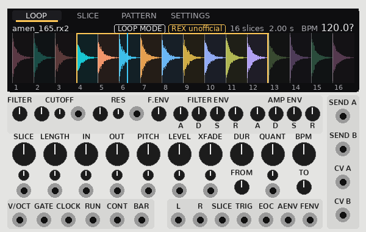
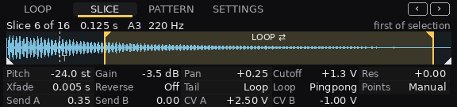
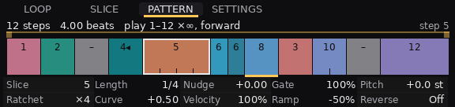

# Spools manual

Spools is a loop player and slicer for VCV Rack 2. It plays REX2, Acidized WAV and plain audio loops slice by slice, in time with your clock, with per-slice settings, a filter and envelopes per voice, and tail modes that loop or stretch a slice to fit its time. It is polyphonic: each V/OCT/GATE channel is its own voice, up to 16.

## Quick start

1. Right-click the module and choose **Load sample…**. Pick a WAV/AIFF/FLAC/MP3/Ogg file or a REX2 loop.
2. Plain audio is sliced automatically at its hits, and its tempo is estimated (shown with a `?`). REX and Acidized files keep their own slices and tempo. Use the SETTINGS page (Slice by, Grid, Sensitivity, Grid snap) to change how it is cut, or **Slice evenly** for equal slices.
3. Patch a gate or trigger into **GATE**. C4 (0 V) on **V/OCT** plays the start slice, and each semitone up or down plays the next or previous slice.
4. Patch a clock into **CLOCK** and set its resolution in the menu. Without one, Spools uses the **BPM** knob, or the loop's own tempo when the knob is at 0.

## Panel

- **Display**: click the tabs along its top to switch pages.
  - **LOOP**: the loop, one colour per slice, with beat and bar lines, a playhead per voice in its slice's colour, and the region marked by an amber bracket (slices outside it are dimmed). The header shows the file, LOOP MODE and REX badges when they apply, the slice count, the length and the current BPM (a `?` means it was guessed).
  - **SLICE**: a close-up of the selected slice (the first one, when several are selected; the playing one when none is). The ‹ › buttons in the tab row step through the slices. It shows the trims, the transient end (dotted line, `T`) and the loop region in amber, faint while automatic and bright once set by hand. Below are the slice's own settings: Pitch, Gain, Pan, Cutoff, Res and Xfade (drag up or down, Shift for fine, double-click to reset), Reverse, Tail, Loop (Forward or Pingpong) and Points (Auto or Manual), which open a menu when clicked, Send A and Send B, the slice's levels at the SEND outputs, and CV A and CV B, its voltages at the CV outputs (±10 V).

    
  - **PATTERN**: the slice-remap pattern for Pattern mode (see [Transport](#transport)).
  - **SETTINGS**: every global option: mode, direction, tail, stretch attack and tail amounts, loop crossfade, loop count, envelope retrigger, slicing, clock resolution, bar length, bars per cycle, interpolation quality and audio embedding. Click a row to pick a value. The same options are also in the right-click menu, grouped as Playback, Slicing, Transport and Engine.
- **Tone strip** (the shaded band under the display): FILTER type (off, low-pass 12 dB, band-pass, high-pass 12 dB, notch, low-pass 24 dB), CUTOFF and RES, each with a CV-amount knob and a CV jack. Cutoff CV is 1 V/oct at 100%; resonance CV is 10 V = 100%. F.ENV sets how far the filter envelope moves the cutoff (±5 octaves). Then come the FILTER ENV and AMP ENV attack, decay, sustain and release knobs (0 to 10 s, exponential).
- **Main row**: SLICE (start slice), LENGTH, trim IN/OUT, PITCH, LEVEL, XFADE (overlap), DUR (gate length in Cut mode), QUANT (launch quantize), BPM. Each knob with a CV jack has a small CV-amount knob above the jack.
- **FROM** and **TO** (region) sit under DUR and BPM.
- **Bottom**: V/OCT, GATE, CLOCK, RUN, CONT and BAR inputs; outputs L, R, SLICE, TRIG, EOC, AENV, FENV.
- **Right column**: the per-slice outputs SEND A, SEND B, CV A and CV B.

The panel is 40 HP.

## Editing slices on the LOOP page

- **Select**: click a slice to select it, and click it again to deselect it. Shift- or Ctrl-click adds a slice to the selection or removes it. Click the header or the slice numbers to clear the selection.
- **Move a boundary**: drag it. It snaps to the slicing grid (SETTINGS → Grid); hold Alt for free movement.
- **Add or delete**: double-click to add a slice (snapped the same way). Ctrl-double-click a boundary to delete it.
- **Trim**: a selected slice shows two white triangles along its bottom edge. Drag them to set the slice's own start and end trim.
- **Region**: drag the amber tabs at the top corners of the bracket. This moves the FROM/TO knobs.
- **Zoom and scroll**: the scroll wheel zooms around the pointer, and dragging with the middle button scrolls. A bar along the bottom shows where you are.
- Every edit can be undone with Rack's Undo.

### Editing selected slices with the knobs

While slices are selected, IN, OUT, PITCH, LEVEL, XFADE, CUTOFF and RES edit those slices instead of the whole module. Each knob jumps to the selection's average, and an amber ring shows the range from the lowest to the highest selected slice. Turning a knob moves every selected slice by the same amount, so their differences are kept. Shift-click a knob to set all selected slices to their average first. When you clear the selection, the knobs go back to their global settings. CV always modulates the global settings, and the patch always saves the global values.

## Playing slices

- Each trigger plays **LENGTH** slices. Each slice starts on its own beat position, scaled to the current tempo. Pitch is independent of tempo.
- A gate held past the first slice keeps repeating the phrase, up to **LOOP COUNT** passes (0 = forever). Releasing it finishes the current slice.
- **DIRECTION**: forward, reverse, ping-pong (alternating passes) or random.
- **QUANTIZE** delays triggers to the next 1/32 … 1 bar.
- **REGION** start/end limit which slices are reachable. Note offsets wrap inside the region.
- **TAIL** decides what happens when a slice's time slot and its audio differ in length: *Ring*, *Cut*, *Loop*, *Auto-loop* or *Stretch* (see [Tail modes](#tail-modes)). A slice can have its own tail mode, which wins over the global one.
- **OVERLAP** is how long a slice keeps fading out after the next one starts.
- **Per-slice settings** add to the knobs: a slice's own pitch, level, pan, trims, cutoff, resonance and crossfade are offsets on top of the knob and CV values. The sums are limited to a usable range (for example ±48 semitones, +12 dB). Pitch, level, cutoff and resonance follow knob and CV changes while a slice plays, with a 5 ms glide. The other settings are read when each slice starts.
- **Envelopes** restart on each slice by default, so every hit gets its own attack. Set **Retrigger** to *Each note* on the SETTINGS page runs them once per triggered phrase instead. The amp envelope's release starts when the note ends (gate released, or the Cut time is up). A release shorter than OVERLAP uses the overlap fade instead. The default (no attack, full sustain, no release) leaves the sound unchanged.

## Transport

Set **Mode** to *Loop* on the SETTINGS page plays the region continuously on the clock instead of on gates; the display header shows LOOP. It starts at the SLICE knob's slice and keeps each slice's own timing, so it stays in step with the bar however the clock moves. **Direction** and **Loop count** work per pass through the region (loop count 0 = forever). GATE is ignored. V/OCT shifts which slice sounds in each slot by one slice per semitone, for beat-repeat and re-chop effects; each poly V/OCT channel runs its own copy.

Set **Mode** to *Pattern* plays a slice-remap pattern on the same transport, for re-chopping. A pattern is a list of steps. Each step names a slice (or a rest), its length on a 1/32-note grid, a nudge (up to a tick early or late, without moving the grid), a gate length, reverse and a pitch offset. A step can also *ratchet*: play its slice 1–8 times within the step, evenly or as a roll that speeds up or slows down (the ratchet curve), with a velocity for the first hit and a ramp that raises or lowers the following ones. When you load a file, the pattern starts as the loop itself, one step per slice of the region, so it sounds like loop mode until you edit it. V/OCT shifts the slice of every step, the pattern's direction reverses or shuffles its steps per pass, and its loop range and count work like loop mode's.

The **PATTERN** page edits it. Steps are blocks along the page, as wide as their length and tinted with their slice's colour (grey for rests, brighter for higher velocity; ratchet hits are notched along the bottom). The amber bracket is the play range.

- Click a step to select it; its settings appear below.
- Drag a step up or down to change its slice; below the first slice is a rest. Alt-drag sets its velocity.
- Drag a step's right edge to change its length, on the 1/32 grid.
- Scroll over a step to change its ratchets.
- Drag the bracket's tabs to set the play range.
- Double-click a step to duplicate it, Ctrl-double-click to delete it, or double-click past the last step to add a rest.
- The fields work like the SLICE page's: drag a number (Shift for fine), double-click to reset, click Reverse to toggle.

Right-click → **Pattern** has **Init from loop** (one step per slice again), **Shuffle slices** (new slice order, same rhythm), **Reverse steps**, **Add rest at end**, **Delete selected step**, **Play every step**, **Direction** and **Loop count**. Every edit can be undone. The pattern is saved with the patch and in the embedded audio's `spls` chunk. Changing the slicing (re-slice, slice evenly, crop) makes a fresh pattern from the new slices.

RUN, CONT and BAR drive loop mode. RUN is a gate: high runs the loop, and its rising edge restarts it at the start slice. Unpatched means always running. CONT restarts at the start slice on the next clock pulse (at once with no clock). BAR realigns the bar count without moving the playback position. The SETTINGS page (or right-click → **Transport**) sets the **Bar length** (from the loop's meter by default) and **Bars per cycle**, which restarts the loop automatically every N bars (∞ = only on CONT).

**Direction**, **Tail** and **Loop count** are on the SETTINGS page (or right-click → **Playback**).

## Tail modes

The tail decides what a slice does when its time slot and its audio differ in length. Each slice can override the global tail on the SLICE page.

- **Ring**: the slice plays to its end, or until the next slice starts.
- **Cut**: the slice is gated at DUR × its slot and fades out over the overlap time.
- **Loop**: the slice plays its attack once, then repeats its loop region until the gate (DUR × slot) ends, so short hits can sustain through long slots. The region runs from the transient end to the slice end unless you set it by hand. Drag the amber flags on the SLICE page to set it, and double-click the waveform to return to automatic. Loops play forward with a crossfade (**Loop xfade** on the SETTINGS page, 10 ms by default) or ping-pong without one. Reversed slices play once without looping.
- **Auto-loop**: as Loop, but the loop is searched for when the slice is analysed. For pitched sounds its length is a whole number of periods; otherwise lengths from 20 ms up are tried. Each candidate is scored on how well the audio before its end matches the audio before its start (shape, level and brightness), longer loops win ties, and both ends sit on rising zero crossings. The SLICE page shows the loop found and its score (FOUND 97 %). Manual points are ignored in this mode; dragging a flag switches that slice to Loop with manual points. When nothing is found, it behaves like Loop.
- **Stretch**: the slice is time-stretched or squeezed to fill its gate exactly, at its original pitch. The attack plays as recorded; the rest plays as overlapping grains. Grains are about three pitch periods long (10–100 ms) and kept in phase with each other for pitched sounds, or 40 ms with a little random jitter otherwise. Two SETTINGS rows shape it: **Keep attack** (how much of the attack, up to the transient end, keeps its own timing; 100 % by default) and **Stretch tail** (how much of the remaining audio, counted back from the end, may be stretched; the rest plays at normal speed). The SLICE page shades the stretched part and shows the grain size.

## Crop and tempo

Click **CROP** at the right of the tab row to see the whole file, with the cropped part bright between two amber handles. Drag a handle to move that edge, or drag inside the window to slide it. The new crop applies when you let go. Click **CROP** again to go back to the slices.

Right-click → **Crop** sets the crop by typing. Type a start and a length and press Enter. A bare number uses the chosen **Units**; a suffix overrides it: `1.5 s`, `250 ms`, `4 b` (beats), `2 bars`, `1000 smp`. Leave the length empty to play to the end, or pick **Whole file**. Cropping plain audio slices it again; REX and Acidized files keep the slices inside the crop.

Right-click → **Loop tempo** sets the loop's own tempo, which fixes where each slice sits in beats. Type a BPM, **Halve** or **Double** it, or click **Tap tempo** on each beat (the menu stays open). A detected tempo shows `?` on the display until you set one. The **BPM** knob is separate: it sets the playback tempo when no clock is patched.

## Auto-slice

The SETTINGS page (or right-click → **Slicing**). Every change re-slices at once, and the setting is saved with the patch. Re-slicing resets per-slice settings.

- **Mode**: *Onsets* cuts at each detected hit. *Grid* cuts at every grid step. *Hybrid* uses the grid plus any strong hit that falls between grid lines.
- **Grid**: 1/4 to 1/32 notes, or 1/8 and 1/16 triplets.
- **Sensitivity**: higher finds quieter hits.
- **Grid snap**: in Onsets mode, moves each hit toward its nearest grid line, from 0% (where it was found) to 100% (on the grid).
- **Re-slice now** applies the settings to a REX or Acidized file too, replacing its own slices.

## Inputs

Every input is polyphonic; channel *n* drives voice *n*. The CV inputs next to a knob are scaled by the small knob above them.

| Input | |
|---|---|
| V/OCT | slice offset: C4 (0 V) plays the start slice, each semitone moves one slice |
| GATE | starts a phrase on the rising edge; holding it repeats the phrase |
| CLOCK | tempo, at the clock resolution set on the SETTINGS page |
| RUN, CONT, BAR | loop-mode transport (see [Transport](#transport)) |
| SLICE, LENGTH | start slice (10 V spans the region), length (6.4 slices per volt) |
| IN, OUT | start and end trim, 50 ms per volt |
| PITCH | 1 V/oct |
| LEVEL | 10 V adds +2 to the level knob's 0..1 range |
| XFADE | overlap, 5 ms per volt |
| QUANT | launch quantize, one step per 1.7 V |
| CUTOFF, RES | 1 V/oct; 10 V = full resonance |

## Outputs

| Output | |
|---|---|
| L, R | audio, ±5 V, polyphonic |
| SLICE | index of the playing slice at 1/12 V per slice, so it can feed V/OCT directly |
| TRIG | 1 ms pulse at each slice start |
| AENV, FENV | amp and filter envelopes, 0–10 V |
| EOC | 1 ms pulse at the end of each phrase pass |
| SEND A, SEND B | each voice's mono mix (after its filter and amp envelope) times the playing slice's Send level, ±5 V, polyphonic. Patch them into effects and mix the returns with L and R. |
| CV A, CV B | the playing slice's CV A or CV B voltage (SLICE page), polyphonic. It changes when a slice starts and holds after the slice ends, so it can drive anything that should follow the slices: an effect's mix, a second filter, a sequencer's transpose. |

## Engine

**Quality** (SETTINGS page): *Best* reads audio with 16-tap windowed-sinc interpolation, *Eco* with 8 taps. Both band-limit when a slice is pitched up. Sixteen voices use about 3–5 % of one core on a 2.1 GHz server CPU (see `docs/development.md`); a voice that has been silent for 0.1 s costs almost nothing.

## Saving

The patch stores the slice map and per-slice settings. With **Embed audio in patch** on (the default), the cropped loop (up to 5 minutes) is saved inside the patch too, so it opens on another machine without the original file.

## Supported files

WAV (16/24/32-bit PCM, 32-bit float, RF64), AIFF/AIFC, Wave64, FLAC, MP3 and Ogg Vorbis. Stereo and mono files play as they are. Files with more channels use the first two. Files longer than 30 minutes are rejected.

### Loop metadata in WAV files

Spools reads Acidized WAV tempo and beat count (`acid`), slice markers (`cue ` points, named by `LIST/adtl/labl`), and the sampler loop and root note (`smpl`). Exports write the same chunks, so slices and tempo survive a round trip through other tools. Per-slice settings go in an extra `spls` chunk, which other software ignores.

### REX files (unofficial)

Spools reads REX2 (`.rx2`) files with its own decoder, built from public reverse-engineering work. It is not made or endorsed by Reason Studios, so please report problems here and not to them. REX1 `.rex`/`.rcy` files are not supported yet. To use one, re-save it as `.rx2`, or export it as WAV with slice markers.
